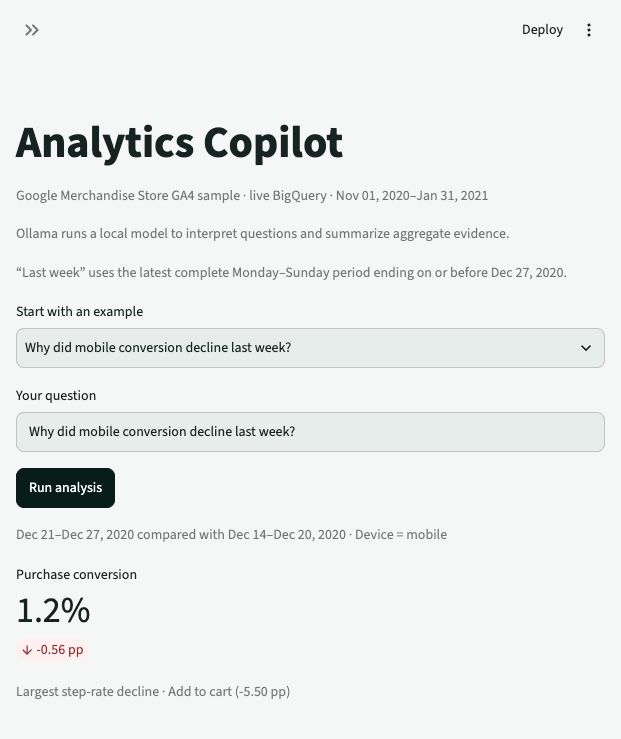

# Funnel Intelligence

A product analytics dashboard for GA4 e-commerce data. It reconstructs shopping sessions from nested events, measures where shoppers drop off, and provides an Analytics Copilot that translates questions into bounded, reproducible reporting queries.

## Run the demo

Use Python 3.12. From the project directory:

```sh
python3.12 -m venv .venv
source .venv/bin/activate
python -m pip install -r requirements.txt
python scripts/build_demo.py
streamlit run app.py
```

The build generates deterministic, synthetic **raw GA4-shaped events** and transforms them through dbt Core and DuckDB. Streamlit labels the data source throughout the app. The demo runs without a Google account or model API key. Its example matcher supports the built-in prompts and similar wording.

1. Open **Analytics Copilot** and run **Why did mobile conversion decline last week?**
2. Inspect both weekly windows and the purchase step in the comparison funnel.
3. Expand **SQL and query parameters** to see the report queries.
4. In **Overview**, set the device to **mobile** and the dates to **Jan 25–31, 2021** to reproduce the headline result.

The synthetic fixture contains a deliberately simulated mobile decline. The [real GA4 case study](CASE_STUDY.md) uses the verified public dataset.

## Verified public-data results

The full 92-day build processed 4,295,584 events and reconstructed 360,129 eligible sessions, including 4,848 purchasing sessions and 4,451 distinct canonical orders. All nine dbt checks passed. The real investigation compares December 21–27 with December 14–20, 2020: mobile conversion fell from 1.75% to 1.19%, and the largest ordered step-rate drop was product view to add to cart (−5.50 pp). See the [case study](CASE_STUDY.md) for the evidence, channel contributions, and limitations.



[View the trend and funnel chart](docs/copilot-funnel.jpg).

## Run against the public Google dataset

The source is Google’s obfuscated Merchandise Store export from **November 1, 2020 through January 31, 2021**. Use a Google Cloud project with the BigQuery API enabled and permission to read the public source and create reporting models in a US dataset. [Public GA4 sample](https://developers.google.com/analytics/bigquery/web-ecommerce-demo-dataset) · [BigQuery Sandbox](https://docs.cloud.google.com/bigquery/docs/sandbox)

Authenticate locally with Application Default Credentials and set the project that will run the query jobs. The first run builds a seven-day slice in the separate `funnel_validation` dataset and compares sessions, orders, and coverage with independent queries against raw events.

```sh
gcloud auth application-default login
export GOOGLE_CLOUD_PROJECT='<your-project-id>'
python scripts/validate_bigquery.py
```

Use `--validate-only` to repeat the reconciliation without rebuilding. Run a full-history build into a separate reporting dataset after validating the slice.

```sh
export FUNNEL_BQ_DATASET='funnel_analytics'
dbt build --project-dir warehouse --profiles-dir warehouse --target bigquery
FUNNEL_MODE=bigquery streamlit run app.py
```

To retain the verified reports when the Sandbox tables expire:

```sh
python scripts/export_snapshot.py
FUNNEL_MODE=snapshot COPILOT_PROVIDER=ollama streamlit run app.py
```

The local snapshot includes the reporting tables and hashed keys for event-sequence review. It lives under the ignored `.data/` directory and is labelled separately from live BigQuery and the synthetic fixture.

Use the [day-by-day audit SQL](warehouse/audits/audit_sample.sql) and the app’s coverage report for additional checks. Use separate identities for dbt writes and hosted app queries. The app identity needs permission to run query jobs and read the reporting tables in `funnel_analytics`. Report jobs dry-run before execution and use a configurable scan cap, `FUNNEL_MAX_BYTES`, defaulting to 256 MiB per query. dbt uses an independent 50 GiB per-job cap in its profile. If the warehouse objects expire, rerun the build within your Sandbox quotas.

## Enable a language model

Use either local Ollama or Gemini. For Ollama, start the service and make sure the model is installed.

```sh
ollama pull llama3.2
COPILOT_PROVIDER=ollama OLLAMA_MODEL=llama3.2:latest streamlit run app.py
```

The local provider uses Ollama's JSON Schema structured output. It receives the question, permitted filters and computed evidence, and runs at `127.0.0.1:11434`.

### Gemini

Configure `GEMINI_API_KEY` and `GEMINI_MODEL` in the environment before launching Streamlit. Use a [Gemini model that supports structured output](https://ai.google.dev/gemini-api/docs/structured-output). The project reads credentials from the environment. Gemini receives the question, available filter labels, and aggregate evidence for the summary. The application validates requested dates and filters, compiles approved read-only SQL templates, builds figures, and renders quantitative claims from results.

## Metric definitions

| Metric | Definition |
|---|---|
| Session | Usable pseudonymous user identifier and positive GA4 session ID. Date comes from the start event, with earliest observed date as fallback. |
| Purchase conversion | Eligible sessions with a purchase event divided by all eligible sessions. |
| Ordered funnel | Session → item view → add to cart → checkout → purchase. Each timestamp must be strictly later than the preceding stage. Same-timestamp events are conservatively treated as ambiguous. |
| Product purchase rate | Sessions where a purchase of the same item follows a view, divided by viewing sessions for that item. |
| Order and gross USD revenue | First canonical purchase per usable transaction ID. Order coverage and revenue refer to the event date, across all segments. |
| Channel | First-user acquisition channel based on the exported source and medium. |
| Visitor status | First-visit event and consistent session numbers where available. Conflicting or missing signals are unknown. |
| Weekly cohort | Browser identifiers grouped by first observed week. Rates count those identifiers returning in each subsequent fully covered week. |

The sample has a fixed beginning and end, so the first and last sessions may be incomplete. Browser identifiers approximate returning visitors. Session and daily anomaly flags are rules for review. Segment contribution analysis measures arithmetic effects from mix and changes within segments. Dates in the Copilot resolve against the selected historical end date.

## Verification

```sh
python scripts/build_demo.py
python -m pytest
python scripts/check_google_sql.py
```

The dbt build checks session keys, funnel monotonicity, item grain, and order and session reconciliation. Python tests cover report behavior, SQL templates, Copilot date and filter validation, and the Streamlit pages. The GoogleSQL check compiles the BigQuery target and parses the resulting SQL locally. The public Google dataset was validated in BigQuery Sandbox, and the Ollama integration was exercised against the four supported example questions. Gemini remains an optional API-key provider.
